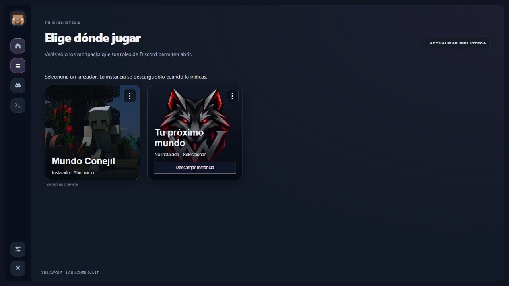
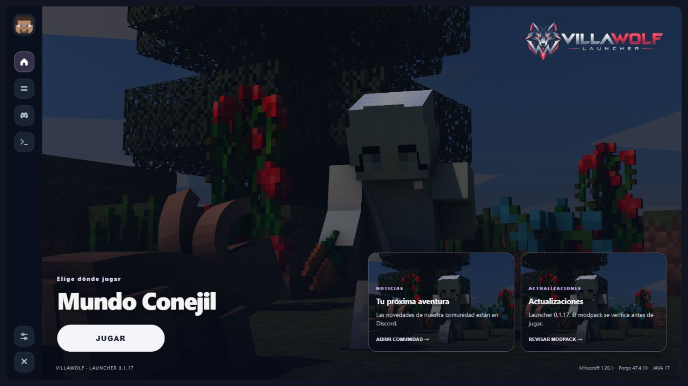
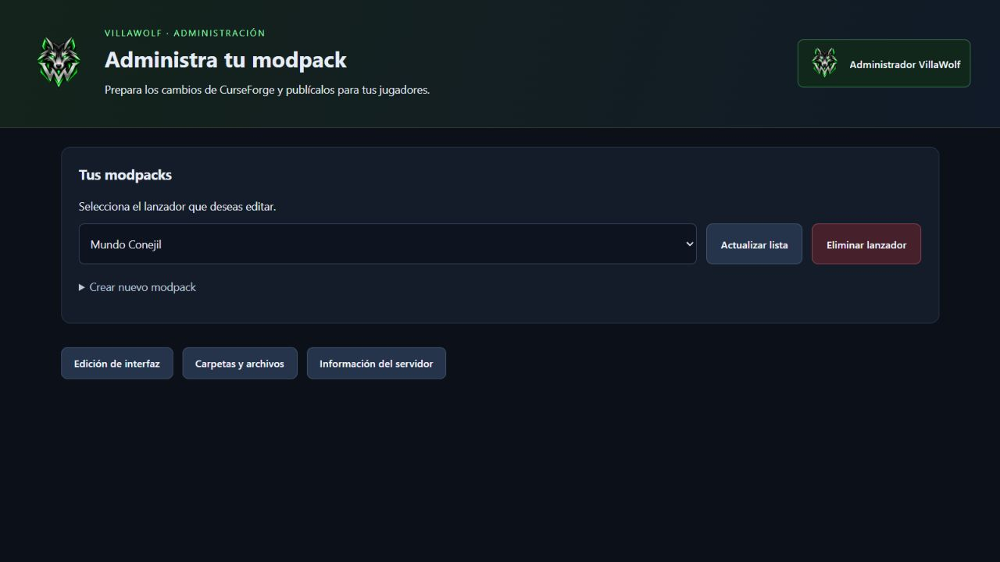
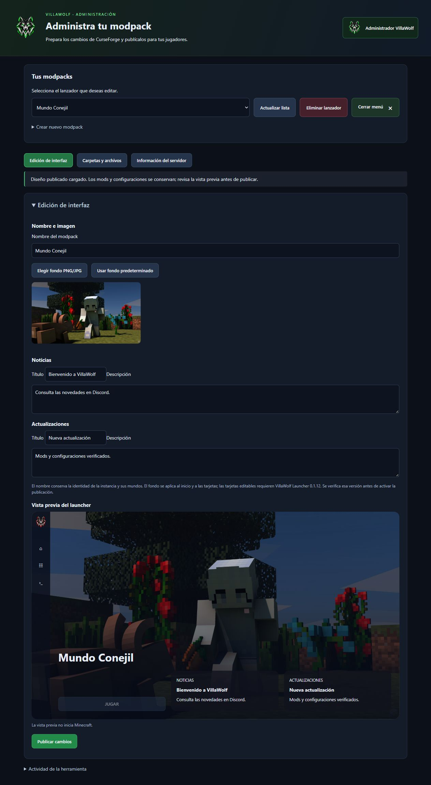
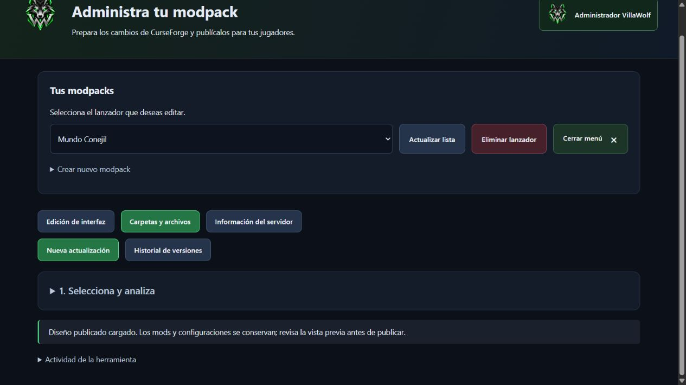

# VillaWolf — guía de uso

Actualizada el 16 de octubre de 2026 para Launcher 0.1.20 y Administrador 0.1.26. Bot público 0.2.5; filtro de diagnósticos antiguos sólo en 0.2.6 local.

**Capturas históricas:** las cinco imágenes siguientes se publicaron el 14 de octubre y representan Launcher 0.1.17 / Administrador 0.1.20 con datos de ejemplo. No son capturas nuevas ni acreditan el aspecto exacto de los menús actuales. Las instrucciones de texto describen el código y el estado documentados; los textos de botones pueden variar.

## Entrar y jugar

1. Instala el Launcher desde su release oficial. Discord es obligatorio: inicia sesión con la cuenta que tenga el rol del modpack en el servidor configurado. Las comunidades externas no requieren pertenecer a VillaWolf.
2. La biblioteca muestra modpacks autorizados. Si la instancia no existe, usa Descargar instancia; seleccionar una tarjeta no instala por sí solo.
3. JUGAR comprueba permiso y archivos, prepara los componentes admitidos y permanece bloqueado mientras Minecraft está abierto. Java y RAM tienen controles propios; no aumentes memoria más allá de la disponible.
4. Si un autor restringe descarga automática, completa la descarga oficial asistida y deja verificar el hash. No importes archivos de otra versión para superar una discrepancia.
5. Microsoft Java Premium es opcional. El código se copia automáticamente, pero debes completar la autorización oficial tú. La cuenta debe tener licencia/perfil Java; vincularla utiliza su nombre/UUID/skin oficiales y puede cambiar inventario respecto a una identidad offline. Avatar Discord o skin Premium son opciones del Launcher, no una migración de mundos.
6. Sesiones guardadas cifradas no significan que nunca venzan. Si Discord impone pausa, respétala; retirar rol bloquea acceso y no repara datos dañados.

## Crear y publicar

1. Administrador requiere Administrador u Owner del servidor oficial. Perfil muestra la conexión GitHub central; no recibes su token.
2. Crear nuevo lanzador: Información → Archivos → Discord → Publicación. Guardar borrador conserva datos, no publica. Continuar permite preparar, revisar y publicar mediante las comprobaciones existentes.
3. Elige la carpeta original CurseForge y prueba allí el juego; VillaWolf no modifica sus originales. Forge es el loader liberado. Un perfil validado no certifica todos sus mods/mundos.
4. Para actualizar: selecciona el lanzador, Carpetas y archivos → Nueva actualización; revisa Carpeta, Contenido, Comprobación y Publicación. Selecciona contenido y resuelve fuentes oficiales; prepara el paquete y confirma tu revisión/prueba real antes de publicar.
5. Hasta tres intentos por archivo comparten fallos HTTP/integridad; no cambies hashes. Si sigue fallando, copia el diagnóstico y detén la publicación.
6. Edición de interfaz cambia nombre/fondo/noticias sin cambiar mods/versión. Configuración de Discord permite servidor, rol, canales opcionales y menciones. Información del servidor sigue No disponible.
7. Historial prepara recuperación como una versión nueva superior. No restaura partidas ni sobrescribe commits históricos.

## Después de publicar

Sólo una publicación confirmada genera avisos. El canal configurable del pack y la copia central en `1559335322926710794` son mensajes independientes. La copia central incorpora notas y administrador verificado, sin menciones; la primera entrega real de esa función de Worker 1.2.4 aún está pendiente. La auditoría permanece en registro.

Errores de aplicaciones: Ver diagnóstico / Copiar error y log ofrecen detalle privado a administradores. Discord no escribe directamente en el portapapeles del equipo: la opción proporciona texto seleccionable. Fecha del diagnóstico y hora de entrega pueden ser distintas por la cola. El Bot 0.2.6 local no anuncia diagnósticos de más de una hora y conserva sus registros.

## Borrado y problemas de limpieza

Eliminar instalación local pregunta y borra sus mods, configuraciones y mundos en esta PC. Eliminar lanzador administrativamente es definitivo para sus instalaciones VillaWolf en clientes compatibles al conectarse, conservando originales CurseForge y commits de Git. No lo uses para reparar acceso.

Si aparece «Limpieza pendiente» con error JSON, no borres mundos ni restablezcas la cola a una lista vacía. En esta PC se restauró `metadata/deleted-packs.json` desde el catálogo oficial con respaldo. 0.1.20 no contiene recuperación automática; reinstalar o quitar roles puede conservar el problema. La protección adicional sigue local, pendiente de distribución autorizada.

[Estado y límites](../../ESTADO_DESARROLLO.md) · [Administrador](../../tools/admin-modpack/README.md) · [Bot](../../auth-server/roles-bot/README.md).

